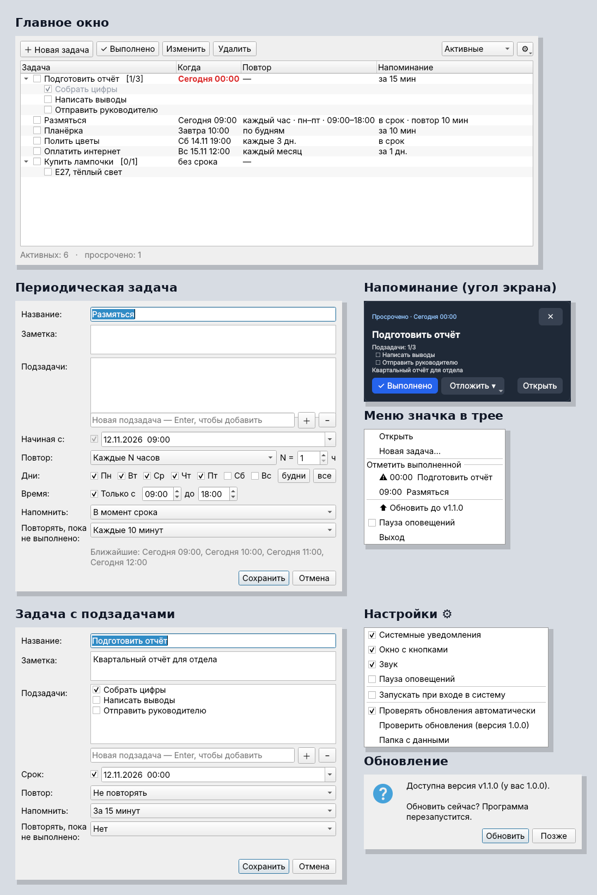

# Задачи — трекер в трее



Один файл `task_tray.py` (Python 3.9+ и PySide6). Работает на Windows, Linux и macOS.

## Запуск

```
pip install PySide6
python task_tray.py
```

На Windows можно запускать без консоли: `pythonw task_tray.py`.
С флагом `--hidden` приложение стартует свёрнутым в трей. Так оно запускается при автозапуске.

## Сборка .exe (Windows)

Запустите `build.bat` (нужен Python с python.org) — готовый файл появится в `dist\Tasks.exe`.

## Обновления

Обновления распространяются через GitHub Releases.

**Один раз:**
1. Репозиторий должен быть **публичным** (иначе программа не сможет проверить релизы без токена).
2. Проверьте, что в `task_tray.py` строка `UPDATE_REPO` указывает на этот репозиторий.

**Выпуск новой версии:**
```
git commit -am "что изменилось"
git tag v1.1.0
git push && git push --tags
```
GitHub сам соберёт `Tasks.exe`, подставит номер версии из тега и опубликует релиз с `Tasks.exe` и `task_tray.py`.

**Что происходит у пользователя:** программа проверяет обновления через 20 секунд после запуска и затем раз в 6 часов. Найдя новую версию, она показывает уведомление, а в меню значка появляется пункт «⬆ Обновить до v1.1.0». После подтверждения программа скачивает файл и перезапускается уже в новой версии. Задачи при этом сохраняются: они лежат отдельно от программы.
- Версия `.exe` заменяет сам `.exe`, а при запуске из исходника заменяется `task_tray.py` (старая копия сохраняется в `task_tray.py.bak`).
- Проверить вручную можно в меню ⚙ → «Проверить обновления». Там же отключается автопроверка.

## Возможности

- **Задачи**: разовые, без срока или с повтором:
  - каждые N минут или часов (можно ограничить днями недели и временем, например «каждый час с 9 до 18 по будням»);
  - каждые N дней;
  - по будням или по выбранным дням недели (раз в N недель);
  - каждые N месяцев.
- **Подзадачи**: чек-лист внутри задачи с прогрессом `[2/5]`. Их можно отмечать прямо в списке. Когда отмечена последняя, приложение предложит закрыть всю задачу. У повторяющейся задачи чек-лист сбрасывается при каждом выполнении.
- **Напоминания**: в момент срока или заранее (от 5 минут до 1 дня). Можно включить повтор оповещения каждые N минут, пока задача не выполнена.
- **Оповещения**: системное уведомление, всплывающее окно с кнопками «Выполнено», «Отложить» и «Открыть», звук. Всё включается и отключается в меню ⚙. Там же есть пауза оповещений.
- **Трей**: значок становится красным, если есть просроченные задачи. В меню значка можно отметить сегодняшние задачи выполненными.
- **Отметка о выполнении**: разовая задача уходит в «Выполненные», у повторяющейся срок переходит на следующее срабатывание.
- Автозапуск при входе в систему: Windows и Linux, включается в меню ⚙.
- Закрытие окна сворачивает приложение в трей. Выход — через меню значка.

Данные хранятся в `tasks.json` в папке приложения. Путь показан в меню ⚙ → «Папка с данными».
